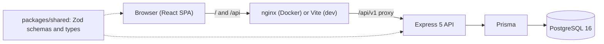
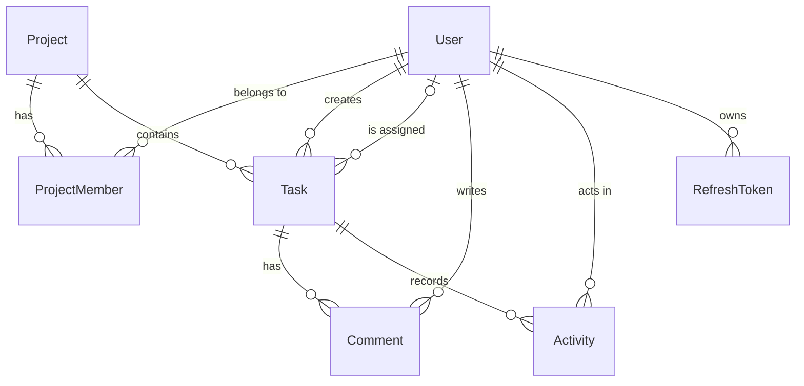
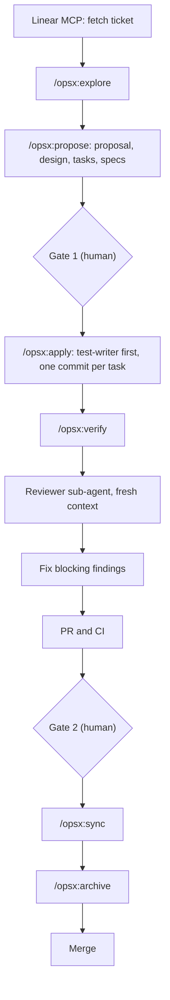

# Team Task Tracker

A full-stack app where authenticated users create projects, manage tasks, assign members, track status, priority and due dates, and view comments and activity history. Access is role-based and scoped per project (OWNER, MEMBER). It is a pnpm monorepo built with the SDD (spec-driven development) guide workflow, using Claude Code, OpenSpec, Linear MCP and Context7 MCP.

## Highlights

- Role-based projects: OWNER and MEMBER per project; non-members get 404, members without permission get 403.
- Tasks with validated status transitions (TODO, IN_PROGRESS, IN_REVIEW, DONE), priority, due date and assignee.
- Filtering, sorting and pagination on the task list.
- Comments and an append-only activity history per task.
- One-command run with Docker: `docker compose up --build` starts PostgreSQL, migrations, demo data, API and web app.
- Built with an SDD workflow across 18 tickets, each with approved specs, test-first tasks, an independent review and two human gates.

## Features

**Auth** (FR-AUTH)

- Register with email, display name and password; log in; log out; refresh the access token.
- Generic error on wrong credentials; passwords stored only as argon2id hashes.
- Refresh tokens rotate on every refresh and are revoked on logout; reuse of a revoked token is rejected.

**Projects and members** (FR-PRJ)

- Create a project (creator becomes OWNER); list only your own projects; view, update and archive.
- Add and remove members (OWNER only); the last owner cannot be removed.
- Archived projects are read-only and hidden from the default list.

**Tasks** (FR-TSK)

- Create, view, update, assign (to a project member only) and archive tasks.
- Status transitions are enforced (invalid transition: 409); a due date in the past is rejected (400).

**Filtering** (FR-FLT)

- Filter by status, priority, assignee and due date range; sort by status, priority, assignee or due date.
- Pagination with `page` and `pageSize` (default 20, maximum 100).

**Comments and activity** (FR-CMT, FR-ACT)

- Members add comments; authors edit their own; authors or project owners delete.
- Activity entries for task creation, assignment, status change and archiving.

**Frontend** (FR-FE)

- Register, login, projects, project detail with members, task list, task detail, comments and activity.
- Redirects unauthenticated users to login; hides or disables actions the user may not perform.
- Loading, empty and error states, including 401, 403 and 404.
- Lighthouse 95+ target on the production build (login, project list, task list).

## Architecture



- **Layering:** routes, then controllers, then services, then Prisma. Each layer calls only the next one; business logic lives in services.
- **Validation:** a `validate` middleware checks every request body, params and query with Zod schemas from `packages/shared`.
- **Project access:** the `projectAccess` middleware returns 404 for a non-member, 403 for a role that is not allowed and 409 for a write to an archived project. Resource-level checks (for example comment author) are in services.
- **Errors:** `{ "error": { "code", "message", "details"? } }` with 400, 401, 403, 404 and 409.
- **Auth:** access JWT (15 minutes) kept in frontend memory only; refresh JWT (7 days) in an httpOnly, Secure, SameSite cookie, rotated on each refresh; separate signing secrets.
- **One origin:** the page and `/api` share an origin (nginx in Docker, the Vite proxy in dev) so the refresh cookie path `/api/v1/auth` matches.
- **OpenAPI 3.1:** generated from the shared Zod schemas and served at `/api/v1/openapi.json`.

## Tech stack

Exact versions of the tools below: [`docs/VERSIONS.md`](docs/VERSIONS.md). Backend libraries not listed there are pinned in the package manifests.

| Layer           | Technology                      | Version                                                      |
| --------------- | ------------------------------- | ------------------------------------------------------------ |
| Runtime         | Node.js                         | 22.23.3 (`.nvmrc`)                                           |
| Package manager | pnpm workspaces                 | 12.11.2                                                      |
| Language        | TypeScript (strict)             | 6.0.3                                                        |
| Frontend        | React, React DOM                | 19.3.1                                                       |
| Frontend        | Vite                            | 8.3.5                                                        |
| Frontend        | React Router                    | 8.5.1                                                        |
| Frontend        | TanStack Query                  | 5.105.0                                                      |
| Frontend        | Tailwind CSS, shadcn/ui (Radix) | 4.3.3                                                        |
| Backend         | Express                         | 5.3.0 (`backend/package.json`)                               |
| Auth            | jose, @node-rs/argon2           | 6.2.13, 2.2.2 (`backend/package.json`)                       |
| Database        | PostgreSQL (Docker image)       | postgres:16.15-alpine                                        |
| ORM             | Prisma                          | 7.10.1                                                       |
| Validation      | Zod                             | 4.6.7                                                        |
| Unit and API    | Vitest, Supertest               | 5.0.5, 7.3.1 (`backend/package.json`)                        |
| End-to-end      | Playwright                      | 1.61.1                                                       |
| Performance     | Lighthouse                      | 13.6.0                                                       |
| Quality         | ESLint, Prettier, Husky         | 10.14.0, 3.9.10, 9.1.7                                       |
| Spec workflow   | OpenSpec CLI                    | 1.16.0                                                       |
| Images          | node, nginx-unprivileged        | node:22.23.3-slim, nginxinc/nginx-unprivileged:1.30.6-alpine |

## Folder structure

```text
backend/
  src/routes/        route definitions with validate and project-access middleware
  src/controllers/   HTTP to service calls and back
  src/services/      business logic and Prisma calls
  src/middleware/    authenticate, validate, project-access, error handler
  prisma/            schema.prisma and migrations
  Dockerfile         multi-stage, non-root (targets: migrate, runtime)
frontend/
  src/pages/         login, register, projects, project detail, task list, task detail
  src/components/    layout, dialogs, comments and activity panels, ui/ (shadcn)
  src/lib/           API client, auth context, helpers
  src/routes/        router and protected route
  nginx.conf         serves the SPA and proxies /api
packages/shared/     Zod schemas, types and the OpenAPI document
e2e/                 Playwright user journey
scripts/             pinning check, E2E and Lighthouse runners, tooling tests
openspec/
  specs/             current behaviour, one spec per capability
  changes/archive/   every finished change (proposal, design, tasks, specs, approvals, review log)
.claude/
  agents/            sub-agent definitions
  hooks/             Claude Code hooks
  commands/opsx/     OpenSpec slash commands
  skills/            OpenSpec and API-convention skills
docs/                FRS, SDS, VERSIONS, workflow, evidence, deviations, traceability, ...
.github/workflows/   CI (ci.yml)
docker-compose.yml   postgres, migrate, backend, frontend
```

## Getting started

### Prerequisites

- Node.js 22.23.3 and pnpm 12.11.2 (`packageManager` in `package.json`; Corepack can provide pnpm).
- Docker with Compose v2 (Docker 29.8.0 was used for the recorded runs).
- Chrome or Edge, only for `pnpm lighthouse`.

### Environment variables

Copy `.env.example` to `.env` and set the values. Never commit `.env`.

| Variable                                        | Purpose                                                           |
| ----------------------------------------------- | ----------------------------------------------------------------- |
| `POSTGRES_PASSWORD`                             | PostgreSQL password (required)                                    |
| `POSTGRES_USER`, `POSTGRES_DB`, `POSTGRES_PORT` | Database user, name and host port (defaults in Compose)           |
| `JWT_ACCESS_SECRET`, `JWT_REFRESH_SECRET`       | Separate signing secrets for the two tokens (required)            |
| `SEED_DEMO_PASSWORD`                            | Password of the demo users (required)                             |
| `FRONTEND_PORT`                                 | Host port of the web app (default 8080)                           |
| `DATABASE_URL`                                  | Connection string for the API, Prisma CLI and seed outside Docker |
| `PORT`                                          | API port outside Docker (default 3000)                            |

The Compose file builds `DATABASE_URL` itself and fails with a clear message when a required variable is missing.

### Option A: Docker (whole app)

```bash
cp .env.example .env        # set POSTGRES_PASSWORD, JWT_ACCESS_SECRET, JWT_REFRESH_SECRET, SEED_DEMO_PASSWORD
docker compose up --build
```

Open <http://localhost:8080>. The `migrate` service applies the migrations and the demo seed and exits, then the backend and frontend start. Demo users (`alice@demo.example` OWNER, `bob@demo.example` MEMBER) and more: [`docs/DEMO.md`](docs/DEMO.md). Stop with `docker compose down` (add `-v` to delete the data).

### Option B: local development

```bash
pnpm install
docker compose up -d postgres                                         # needs the variables above in .env
export DATABASE_URL=...  JWT_ACCESS_SECRET=...  JWT_REFRESH_SECRET=...  SEED_DEMO_PASSWORD=...
pnpm --filter @team-task-tracker/backend exec prisma migrate deploy
pnpm --filter @team-task-tracker/backend build
pnpm --filter @team-task-tracker/backend run db:seed
pnpm --filter @team-task-tracker/backend start                        # API on http://localhost:3000
pnpm --filter @team-task-tracker/frontend dev                         # Vite; proxies /api to the API
```

The Vite dev server prints its URL (the proxy target can be changed with `BACKEND_URL`). The backend has no watch mode: rebuild and restart it after changes.

## API overview

Base path `/api/v1`. Lists use `?page=1&pageSize=20` and `?sortBy=...&sortOrder=asc|desc`. OpenAPI document: `GET /api/v1/openapi.json`.

| Method and path                                         | Purpose                               | Auth           |
| ------------------------------------------------------- | ------------------------------------- | -------------- |
| `POST /auth/register`                                   | Register                              | public         |
| `POST /auth/login`                                      | Log in (access token, refresh cookie) | public         |
| `POST /auth/refresh`                                    | Rotate the refresh token              | refresh cookie |
| `POST /auth/logout`                                     | Revoke the refresh token              | refresh cookie |
| `GET /auth/me`                                          | Current user                          | access token   |
| `POST /projects`, `GET /projects`                       | Create, list own projects             | access token   |
| `GET /projects/:projectId`                              | View project                          | member         |
| `PATCH /projects/:projectId`                            | Update project                        | OWNER          |
| `POST /projects/:projectId/archive`                     | Archive project                       | OWNER          |
| `GET /projects/:projectId/members`                      | List members                          | member         |
| `POST /projects/:projectId/members`                     | Add member                            | OWNER          |
| `DELETE /projects/:projectId/members/:userId`           | Remove member                         | OWNER          |
| `POST /projects/:projectId/tasks`                       | Create task                           | member         |
| `GET /projects/:projectId/tasks`                        | List with filters, sort, pagination   | member         |
| `GET /projects/:projectId/tasks/:taskId`                | View task                             | member         |
| `PATCH /projects/:projectId/tasks/:taskId`              | Update task                           | member         |
| `POST /projects/:projectId/tasks/:taskId/status`        | Change status                         | member         |
| `PUT /projects/:projectId/tasks/:taskId/assignee`       | Assign or unassign                    | member         |
| `POST /projects/:projectId/tasks/:taskId/archive`       | Archive task                          | member         |
| `POST`, `GET .../tasks/:taskId/comments`                | Add, list comments                    | member         |
| `PATCH`, `DELETE .../tasks/:taskId/comments/:commentId` | Edit (author), delete (author, OWNER) | member         |
| `GET .../tasks/:taskId/activity`                        | Task activity history                 | member         |

Permissions per action: [`docs/SDS.md`](docs/SDS.md) section 6.

## Data model



Enums: role (OWNER, MEMBER), status, priority, activity action. UUID ids; projects and tasks are soft-deleted with `archivedAt`; comments are hard-deleted; activity is append-only. Schema: [`backend/prisma/schema.prisma`](backend/prisma/schema.prisma).

## Scripts

Run from the repository root.

| Script              | What it does                                                              |
| ------------------- | ------------------------------------------------------------------------- |
| `pnpm build`        | Build every package                                                       |
| `pnpm lint`         | ESLint plus the pinning check                                             |
| `pnpm typecheck`    | TypeScript check in every package                                         |
| `pnpm test`         | Root `node:test` tooling tests, then each package's Vitest                |
| `pnpm test:e2e`     | Playwright user journey on a throwaway PostgreSQL (needs Docker)          |
| `pnpm coverage`     | Coverage reports (80% line threshold per package)                         |
| `pnpm lighthouse`   | Lighthouse on the production build; median of 5 runs per page, local gate |
| `pnpm format`       | Prettier write                                                            |
| `pnpm format:check` | Prettier check                                                            |

## Testing and quality

| Level                | Tool                    | Result at final integration (DEV-1018)                            |
| -------------------- | ----------------------- | ----------------------------------------------------------------- |
| Tooling and policy   | `node:test`             | 279 passed                                                        |
| Shared schemas       | Vitest                  | 110 passed                                                        |
| Frontend components  | Vitest, Testing Library | 151 passed                                                        |
| Backend unit and API | Vitest, Supertest       | 263 passed (authorization-denied and validation cases)            |
| End-to-end           | Playwright (Chromium)   | 1 journey passed                                                  |
| Coverage             | Vitest v8               | lines 97.62% backend, 92.08% frontend, 100% shared (DEV-1016 run) |
| Lighthouse           | Lighthouse 13.6.0       | 100 in all four categories on the audited pages (stub API)        |

- Evidence: [`docs/evidence/DEV-1018/gates.md`](docs/evidence/DEV-1018/gates.md), [`docs/evidence/DEV-1016/`](docs/evidence/DEV-1016/), security review in [`docs/review/final-review.md`](docs/review/final-review.md). Every spec scenario maps to a test or a reviewer check: [`docs/testing/scenario-test-map.md`](docs/testing/scenario-test-map.md).
- **CI** (`.github/workflows/ci.yml`, on pull requests and pushes to `main`): install with the frozen lockfile, `format:check`, `lint`, `typecheck`, `test`, `build`, `openspec validate --all --strict`, `pnpm audit --audit-level=high`. Actions are pinned to commit SHAs.
- **Pre-commit (Husky + lint-staged):** ESLint with zero warnings and Prettier check on staged files.
- **Pinning check:** `scripts/check-pinning.mjs` (part of `pnpm lint`) rejects version ranges, `latest`, floating image tags and Actions not pinned to a SHA.

## Development workflow (SDD)



Rules: [`CLAUDE.md`](CLAUDE.md), [`AGENTS.md`](AGENTS.md), lifecycle in [`docs/workflow.md`](docs/workflow.md).

**Agents** (`.claude/agents/`)

| Agent               | Role                                                               |
| ------------------- | ------------------------------------------------------------------ |
| `test-writer`       | Writes failing tests from the spec WHEN/THEN scenarios before code |
| `implementer`       | Implements exactly one task against tests that already fail        |
| `reviewer`          | Independent read-only review of the branch against the change      |
| `security-auditor`  | Read-only audit of dependencies, secrets and auth handling         |
| `db-change-checker` | Reviews Prisma schema changes and migrations                       |
| `coordinator`       | Read-only planner that splits task groups into a delegation plan   |

**Hooks** (`.claude/hooks/`)

| Hook                  | Event                     | Purpose                                                                        |
| --------------------- | ------------------------- | ------------------------------------------------------------------------------ |
| `block-dangerous.mjs` | PreToolUse (Bash)         | Blocks force push, push to main, hard reset, `.env` access, `curl` and similar |
| `format.mjs`          | PostToolUse (Edit, Write) | Runs Prettier on the changed file                                              |
| `quality-gate.mjs`    | Stop                      | Runs `pnpm typecheck` and `pnpm test` and blocks finishing on failure          |

**MCP servers** (`.mcp.json`): Linear (issue tracker), Context7 (library docs), code-review-graph (read-only code graph). Setup: [`docs/mcp/README.md`](docs/mcp/README.md).

**Conventions:** branch `feature/{domain}/DEV-XXXX-{short-name}`; commit `type(scope): description (DEV-XXXX)`; one commit per task; no force push and no push to `main`.

## Project documentation

| Document                                                                 | Contents                                               |
| ------------------------------------------------------------------------ | ------------------------------------------------------ |
| [`docs/SUBMISSION.md`](docs/SUBMISSION.md)                               | Submission index with evidence for each required item  |
| [`docs/DEMO.md`](docs/DEMO.md)                                           | Run the app and walk one ticket through the flow       |
| [`docs/RETROSPECTIVE.md`](docs/RETROSPECTIVE.md)                         | Successes, failures, human interventions, improvements |
| [`docs/traceability.md`](docs/traceability.md)                           | Ticket, change, branch, PR and gate commits per ticket |
| [`docs/deviations.md`](docs/deviations.md)                               | Accepted deviations and follow-ups                     |
| [`docs/FRS.md`](docs/FRS.md), [`docs/SDS.md`](docs/SDS.md)               | Functional requirements and software design            |
| [`docs/VERSIONS.md`](docs/VERSIONS.md)                                   | Pinned versions                                        |
| [`docs/mcp/`](docs/mcp/README.md)                                        | Linear and Context7 MCP setup and supported operations |
| [`docs/WORKTREES.md`](docs/WORKTREES.md)                                 | Parallel work with git worktrees                       |
| [`docs/GRAPH-TOOLS.md`](docs/GRAPH-TOOLS.md)                             | Code Review Graph and Graphify                         |
| [`docs/TOKEN-REPORT.md`](docs/TOKEN-REPORT.md)                           | Token-efficiency comparison                            |
| [`docs/review/final-review.md`](docs/review/final-review.md)             | Final independent review of the product                |
| [`docs/testing/scenario-test-map.md`](docs/testing/scenario-test-map.md) | Spec scenario to test map                              |

## Known limitations

Full list: [`docs/deviations.md`](docs/deviations.md).

- The refresh cookie is `Secure`, so the app over `http://localhost` works in Chrome and Firefox but not in Safari (D-150).
- Lighthouse runs as a local gate, not in CI (D-088).
- Branch protection on `main` is post-submission (D-026).
- Rate limiting, security headers and token-family revocation are not implemented (D-137, D-140).
